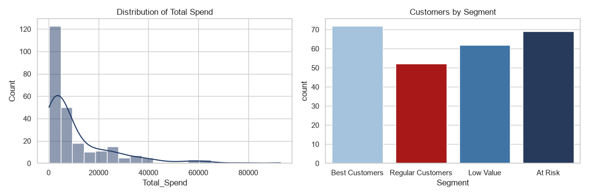
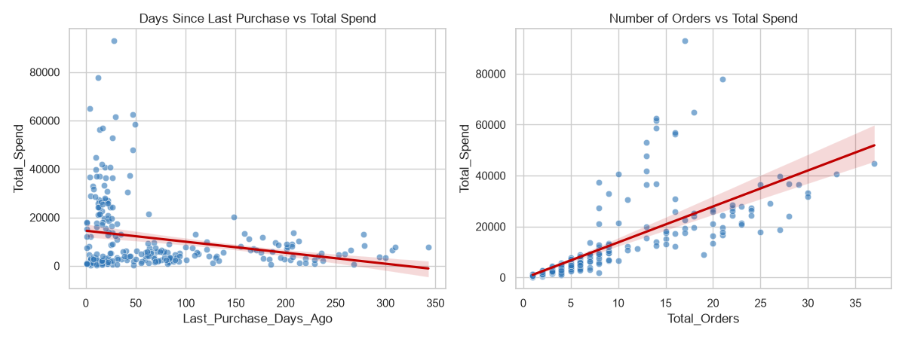
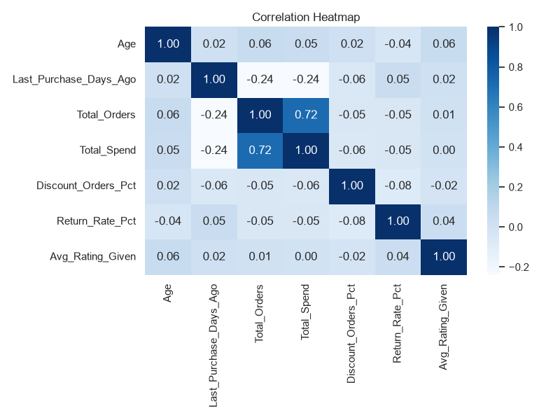
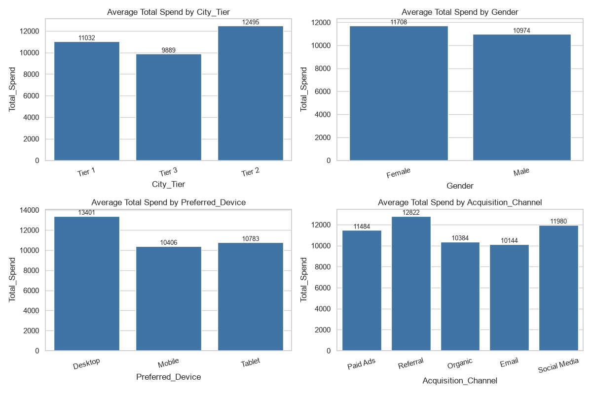
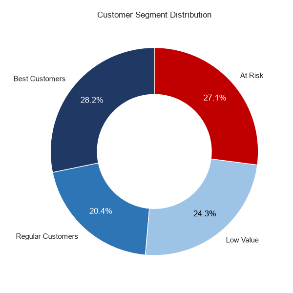

# E-commerce Customer Segmentation (Sample Data Analyst Project)

A beginner-friendly data analysis project for **B.Tech 1st Year – Data Analyst** learners.
It groups online-store customers into segments (RFM analysis) using Python, pandas, matplotlib and seaborn.

> The dataset is **synthetic** (computer-generated). It contains no real customer data.

## Business problem
An online store wants to group its customers into segments so the marketing team can give the right offer to each group.

## Questions answered
1. What is the overall spending behaviour of customers?
2. Do recent purchases and number of orders affect total spend?
3. Does spending differ by city tier, gender, device or acquisition channel?
4. Which customers are at risk of leaving?

## Dataset
`data/raw/ecommerce_customers.csv` – 508 rows, 12 columns (Customer_ID, Gender, Age, City_Tier, Preferred_Device, Acquisition_Channel, Last_Purchase_Days_Ago, Total_Orders, Total_Spend, Discount_Orders_Pct, Return_Rate_Pct, Avg_Rating_Given).
The raw file intentionally has missing values, duplicates, inconsistent text and impossible values (negative spend, age 150) so you can practise cleaning.

## Project structure
```
ecommerce-customer-segmentation/
├── data/
│   ├── raw/ecommerce_customers.csv
│   └── processed/ecommerce_customers_clean.csv
├── notebooks/ecommerce_customer_segmentation.ipynb
├── images/                  (charts saved by the notebook)
├── scripts/generate_data.py (creates the synthetic dataset)
├── requirements.txt
├── .gitignore
└── README.md
```

## How to run
```bash
git clone https://github.com/<your-username>/ecommerce-customer-segmentation.git
cd ecommerce-customer-segmentation
pip install -r requirements.txt
jupyter notebook notebooks/ecommerce_customer_segmentation.ipynb
```

## Steps followed
1. Load and inspect data  2. Clean data (duplicates, text, outliers, missing values)  3. Create new columns (Avg_Order_Value, RFM scores, Segment, Recency_Band)  4. Exploratory analysis with charts  5. Extension tasks (top 10 customers, discount vs spend, donut chart)  6. Insights and recommendations

## Key findings (from this dataset)
- 500 customers generated total revenue of about Rs. 54.4 lakh (average Rs. 10,882 per customer).
- **Best Customers** are about 27% of customers but bring about 71% of revenue.
- Number of orders has a strong positive correlation with total spend (about 0.73); days since last purchase has a weak negative one (about -0.25).
- 132 customers (about 26%) are **At Risk**: they have not bought for about 155 days on average.
- Social Media customers spend the most on average; Email customers spend the least.
- Share of orders placed with a discount has almost no relationship with spend (correlation about -0.05).

## Charts






## Tools
Python 3 · pandas · NumPy · matplotlib · seaborn · Jupyter Notebook · Git and GitHub

## Author
Saksham Tyagi
roll no = 2026B01010020
